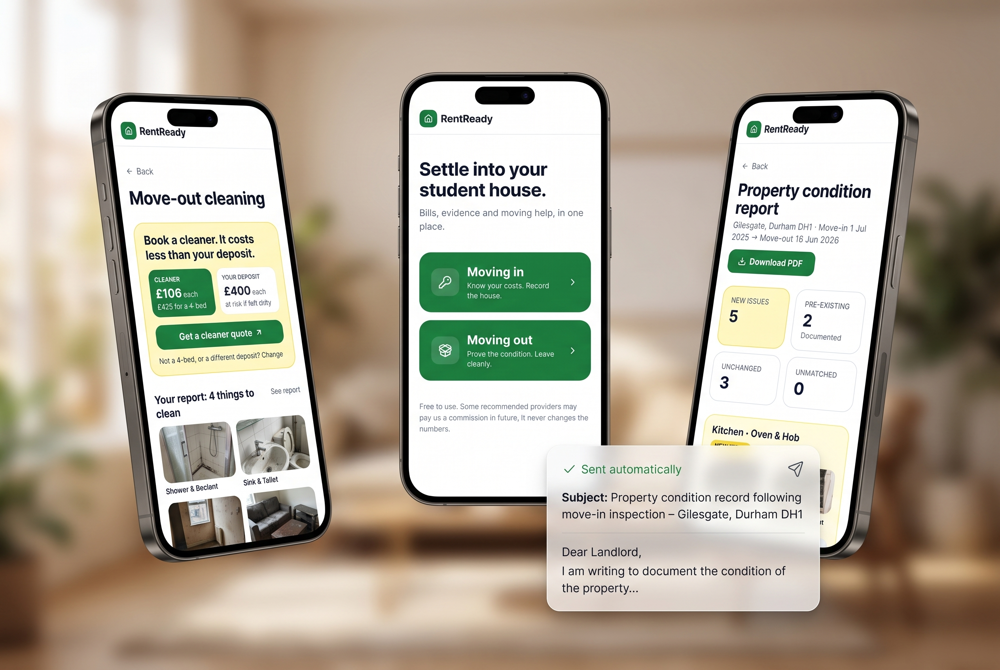
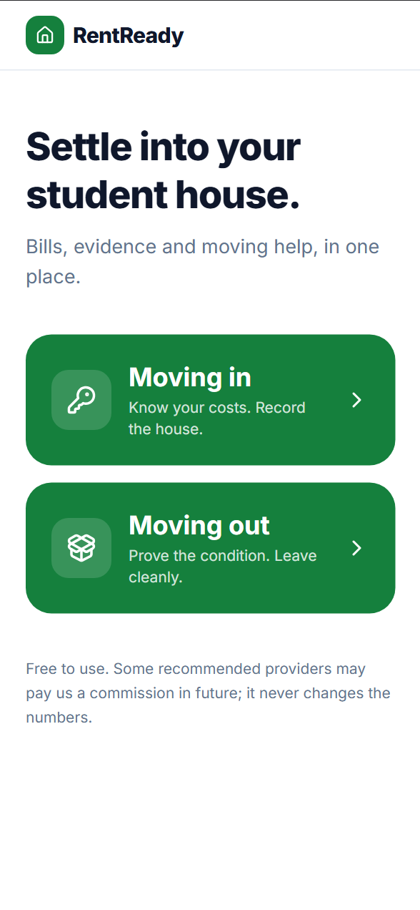
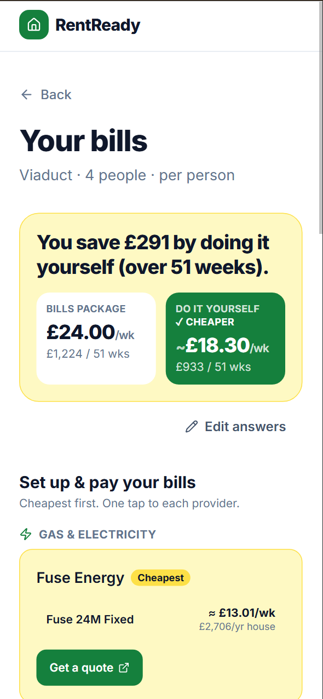
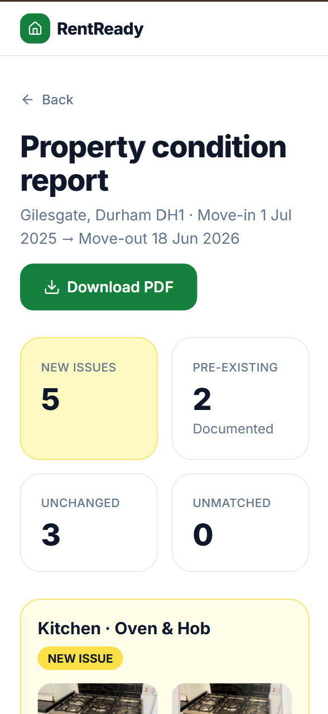
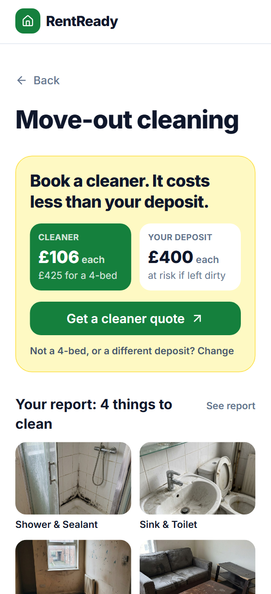

# RentReady

**The free renting companion for Durham students.** Compare your bills, prove the house's condition when you move in and out, and find storage and cleaning, all on your phone.



## Open the app (no install needed)

👉 **https://renanlvrt.github.io/TTRX/**

Open this link on your phone or computer. That's it: nothing to download, no account, works on any Wi-Fi or mobile data.

> **Tip (phone):** in Safari or Chrome, tap **Share → Add to Home Screen** to get a RentReady icon like a normal app.

Nothing is saved: every time you refresh the page, the app starts fresh, like a brand-new user.

## What it does

| | | | |
|:-:|:-:|:-:|:-:|
|  |  |  |  |
| **Two buttons:** moving in or moving out | **Bills:** package or do it yourself? Cheapest providers first | **Before/after report:** photos side by side, new issues flagged | **Cleaning:** cleaner or risk your deposit? |

**Moving in**
1. **Compare bills:** answer a few quick questions and see if a bills package or setting up bills yourself is cheaper, with a link to each provider.
2. **Record the house:** take a photo of each room item (oven, walls, shower…).
3. **Email your landlord:** a ready-to-copy email that documents the condition. You send it yourself.

**Moving out**
1. **Before/after report:** take the same photos again; the app puts them side by side and flags what's new. Download it as a PDF.
2. **Storage:** pick how many boxes and for how long; see the cheapest Durham option.
3. **Cleaning:** based on your report, it tells you whether to book a cleaner or clean it yourself.

All prices are real Durham prices, checked on 17 Oct 2026, with sources.

## Show the demo (presenters)

The demo fills in a sample Durham house with real photos so you only upload one picture live.

1. Open **https://renanlvrt.github.io/TTRX/**.
2. Load the demo house:
   - **Phone:** press and hold the green **RentReady** logo (top left) for about 1 second. You'll feel a small buzz.
   - **Computer:** press **Alt + D**.
3. Tap **Moving out → Before / after report**.
4. On **Kitchen · Oven & Hob**, tap **Add photo** and choose a photo (camera or gallery). Pick **Existing Damage/Marks**.
5. Tap **Build report**: you'll see **5 new issues, 2 pre-existing, 3 unchanged**.
6. Open **Cleaning** to see the advice based on the report.

To start over: refresh the page, hold the logo again, or press **Alt + R**.

> Before presenting, save a photo of a dirty oven to your phone's gallery (e.g. `images of house/gen-01-kitchen-oven-hob-after.jpg` on the team laptop).

---

## For developers

**Start here:** [`SPEC.md`](SPEC.md) (locked scope + every product decision). Background: [`PRD.md`](PRD.md).

Needs [Node.js](https://nodejs.org) 20+.

```bash
npm install
npm run dev     # http://localhost:5173
npm test        # logic unit tests
npm run build
```

- Logic: `src/lib` (pure TS) · State: `src/lib/store.ts` · Data: `src/data` (sources in `research/`)
- UI kit + palette: `src/components/ui.tsx`, `src/index.css`
- Screens: `src/pages/<module>` (thin; designed screens from Stitch replace these)
- **UI teammate:** see [`INTEGRATION.md`](INTEGRATION.md)
- **Deploy:** every push to `main` runs the tests and publishes to GitHub Pages (`.github/workflows/pages.yml`).
